# LivePi User Manual


**LivePi v0.23.2** · Copyright © Jerod Ulicki

LivePi turns a Raspberry Pi into a small, headless VST3 host for live voice. Audio goes in through the Pi's sound card, through your plugins (for example LiveVoice), and back out with very little delay. You control everything from a web page on a phone, tablet or computer. The Pi needs no screen, keyboard or mouse.

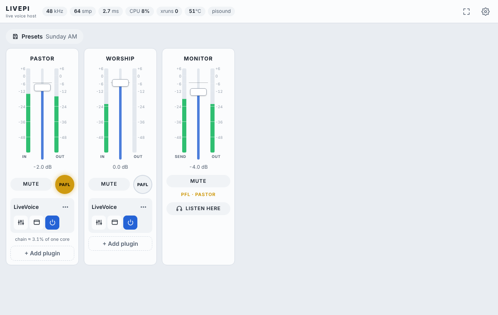

---

## Contents

1. [What you need](#1-what-you-need)
2. [Installing LivePi](#2-installing-livepi)
3. [Opening LivePi](#3-opening-livepi)
4. [The screen at a glance](#4-the-screen-at-a-glance)
5. [The rack](#5-the-rack)
6. [Monitoring (PAFL)](#6-monitoring-pafl)
7. [Working with plugins](#7-working-with-plugins)
   - [Mixer mode](#mixer-mode-built-in-livevoice-channels)
8. [Setup pages](#8-setup-pages)
9. [Password, login and trusted access](#9-password-login-and-trusted-access)
10. [Updating](#10-updating)
11. [Reliability and latency](#11-reliability-and-latency)
12. [Troubleshooting](#12-troubleshooting)
13. [Command reference (on the Pi)](#13-command-reference-on-the-pi)
14. [Where LivePi keeps its files](#14-where-livepi-keeps-its-files)

---

## 1. What you need

| Item | Notes |
|---|---|
| **Raspberry Pi 5** (recommended) or Pi 4 | A Pi 3 works with less headroom. Use a fan or a good heatsink. |
| **Raspberry Pi OS Lite, 64-bit** | Debian 13 "Trixie" (current) or Debian 12 "Bookworm". A 32-bit OS will not work. |
| **Audio interface** | Recommended: **Blokas Pisound** (¼" in/out, about 2 ms loopback). Any card Linux supports works, including class-compliant USB interfaces. You can also start with **no interface** by using the built-in virtual sound card. |
| **Your plugins** | VST3 plugins built for **Linux ARM64 (aarch64)**. Mac and Windows builds will not load. |
| **Network** | A wired connection is best for live use. Wi-Fi works for setup. |

---

## 2. Installing LivePi

### 2.1 Prepare the SD card

1. In [Raspberry Pi Imager](https://www.raspberrypi.com/software/), choose your Pi model and **Raspberry Pi OS Lite (64-bit)**.
2. Before writing, open the settings and set:
   - a **hostname** (for example `livepi`),
   - a **user name** and password,
   - **SSH** on,
   - your Wi-Fi details, if you need them.
3. Write the card, fit your audio interface (for example the Pisound), insert the card and power on. Wait about a minute.

### 2.2 Run the installer

From your computer, connect to the Pi and run:

```bash
ssh your-user@livepi.local
curl -L -o livepi.tar.gz https://github.com/leonidis2013/LivePi/releases/latest/download/livepi-linux-arm64.tar.gz
tar xzf livepi.tar.gz
cd livepi
sudo ./install-pi.sh
sudo reboot
```

The installer sets up LivePi to start at boot, tunes the Pi for low-latency audio (real-time priority, CPU at full speed, PulseAudio and Bluetooth off) and installs the virtual screen used for plugin windows. It asks a few questions along the way:

| Question | What to answer |
|---|---|
| **Will you use a Blokas Pisound?** | **Y** if you have one. LivePi switches on its driver; nothing is downloaded. If a Pisound is already fitted and working, this is done without asking. |
| **Apply all recommended settings?** (live-audio tuning) | **Enter** applies them all. Answer **n** to go through them one by one, each with a short note: reserve a CPU core for the audio, the faster-responding kernel mode, automatic OS updates off, CPU at full speed, the watchdog, USB power saving off, Wi-Fi power saving off and, with a Pisound, letting LivePi use its button. Anything you skip can be fixed later from ⚙ → System → Reliability. |
| **Do you want to set a password? [Y/n]** | **Y** to protect the page with a password (at least 4 characters). **N** lets everyone on your network use LivePi. When you run the installer again and a password is already set, it asks **Keep it?** instead: press Enter to keep your password and trusted access as they are. |
| **Turn on trusted access?** *(only after setting a password)* | **Y** lets devices on networks you trust skip the password. You then enter the network (the Pi's own network is suggested) and can add more. |

You can answer some of these up front:

| Option | Meaning |
|---|---|
| `--password` / `--no-password` | Set a password, or skip it, without being asked. |
| `--pisound` / `--no-pisound` | Set up the Pisound, or don't, without being asked. |
| `--no-tuning` | Don't apply the live-audio OS tuning (section 11). |
| `--no-editor` | Don't install plugin-window support (saves a little memory; the Plugin screen view is then unavailable). |

> **No internet on the Pi?** Download `livepi-linux-arm64.tar.gz` from the [Releases page](https://github.com/leonidis2013/LivePi/releases) on your computer, copy it over with `scp livepi-linux-arm64.tar.gz your-user@livepi.local:`, then continue from `tar xzf`.

> **Upgrading from LiveHost** (the old name)? Run the installer as above. It removes the old service and moves your settings, presets, plugins and password across automatically.

---

## 3. Opening LivePi

### The setup assistant

The first time LivePi is opened, a short **setup assistant** walks through the audio interface, the number of channels and their names, VST rack or Mixer mode, the starting sound for each microphone (mixer mode, including **Lapel**), the network (automatic or a fixed IP address) and the password. In the assistant, **Next** applies what you changed (the audio interface, the number of channels; a network change asks you to confirm first, because the connection can drop). The assistant remembers where it was, so it carries on at the next step on another device or at the Pi's new network address. Skip any step. Run it again any time: **⚙ → Settings → Setup assistant → Run setup**, handy when something isn't working.


Open **`http://livepi.local:8080`** in any browser on the same network. If that name doesn't work, use the Pi's IP address instead, for example `http://192.168.1.50:8080`.

### Logging in

If password protection is on, LivePi shows its own login screen. Type the password only; there is no user name. Each device stays logged in for 30 days.

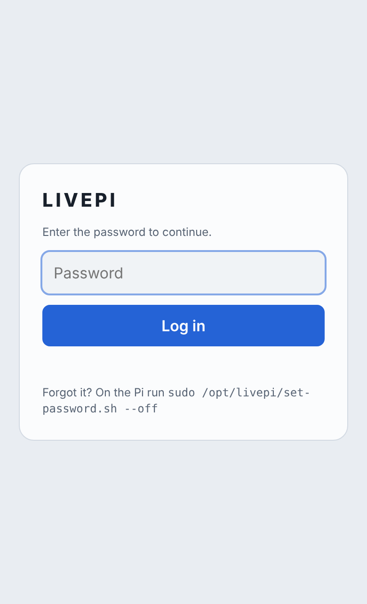

After **10 wrong passwords** that device is locked out for **10 minutes**. The login screen shows a countdown to the next allowed try, and each wrong attempt tells you how many tries are left.

### One device at a time

Only one device can control LivePi at a time. If someone is already using it, the next device sees **"A session is already in progress"**, with where it is in use from and for how long, and a **Take over** button. The device that was taken over then sees **"Another device took over"** with **Take back**.

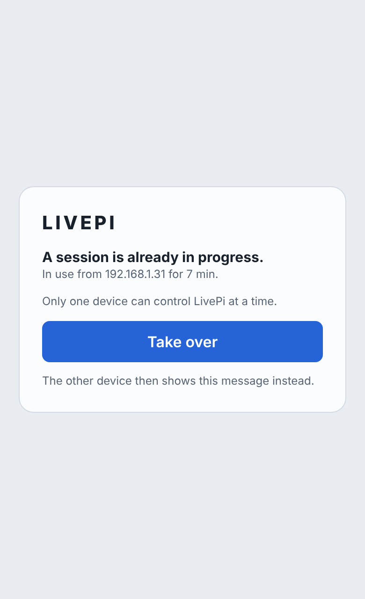

A device that closes the page, or leaves it in the background for about 12 seconds, frees LivePi, and the next device gets in without being asked.

### Full screen and "app" mode

**On an iPad**, Safari's own full screen always shows a ✕ in the top-left corner, and a web page can't hide it. Instead, tap the full-screen button and follow its steps: **Share → Add to Home Screen**, then open LivePi from its icon. It fills the screen with no ✕ and no Safari bars. (It keeps its own login, so you may enter the password once there.) If you use Safari's full screen anyway, LivePi moves its header out from under the ✕.


- **Computer:** press the **⛶** button at the top right. Press it again or press Esc to leave.
- **iPhone or iPad:** in Safari use **Share → Add to Home Screen**. LivePi gets its own icon and opens full screen like an app.

---

## 4. The screen at a glance

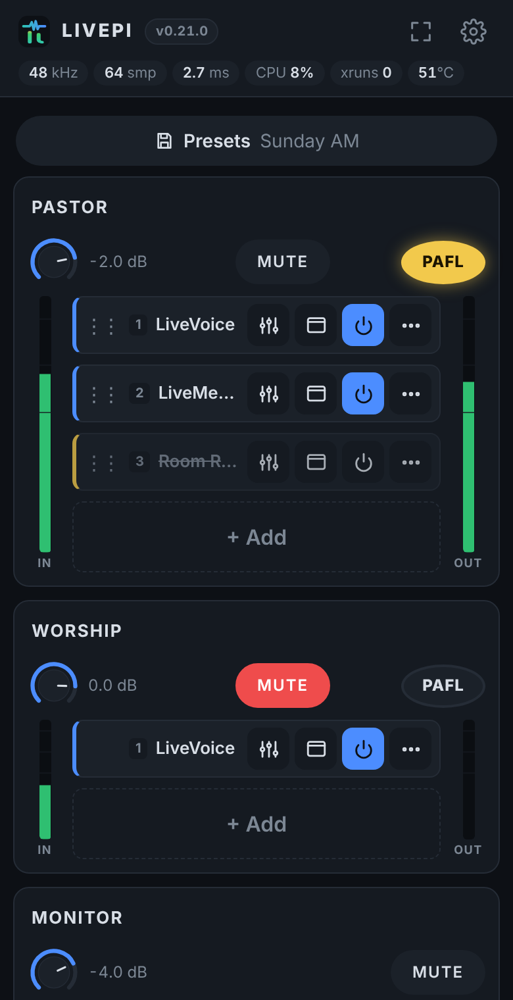

**Top bar**

| Item | Meaning |
|---|---|
| **kHz** | Sample rate of the audio interface. |
| **smp** | Buffer size in samples. Smaller means less delay but more CPU. |
| **ms** | Latency reported by the audio interface. The virtual card shows 0.0. |
| **CPU** | How busy the audio processing is. It turns red above 70 %. |
| **xruns** | Audio dropouts (clicks) since the last reset. Dropouts while LivePi starts up and loads plugins are not counted. It turns red as soon as there is one. **Tap it to reset it to 0**, then watch: if it climbs again, raise the buffer. |
| **°C** | Pi temperature. It turns red above 75 °C. |
| **⛶** | Full screen. |
| **⚙** | Opens the setup pages. In setup it becomes **Done**, which returns to the mixer. |

If the connection to the Pi is lost, the whole page grays out with **"Connection to LivePi lost. Reconnecting…"**. Nothing can be pressed until the Pi answers again, then everything comes back by itself.

---

## 5. The rack

**Faders, graphs and sliders are relative:** touching one never moves it. Slide your finger and it moves by that much from where it is, so a stray tap can't make a sudden jump. Double-tap a fader for 0 dB.

In **VST rack** mode each channel is one row of the rack, with the signal flowing left to right: the **IN** meter, the plugins in order, then the **OUT** meter. (In **Mixer** mode the channels are mixer strips instead: see [Mixer mode](#mixer-mode-built-in-livevoice-channels).)

| Part | What it does |
|---|---|
| **Name** | Tap it (✎) to rename the channel; Enter or tapping away saves. |
| **Level knob** | The channel's output level, from −∞ to +6 dB. Drag up or down; **double-tap** for 0 dB. |
| **MUTE** | Silences the channel's output. |
| **PAFL** | Sends this channel to the Monitor mix (see [Monitoring](#6-monitoring-pafl)). It lights amber when on. |
| **IN / OUT meters** | Level coming in, before the plugins, and going out, after the plugins and the level knob. |
| **Plugins** | One unit per plugin, numbered in signal order (see below). |

The **Monitor** row at the bottom has the monitor mix's level, mute, what PAFL is listening to, and **Listen here**.

With one channel, its output feeds both left and right. With more channels, channel N goes to output N.

**Soft start:** when LivePi starts, the audio device changes, or a preset loads, the outputs stay silent for under a second while the converters and plugins settle, then fade in. The meters ignore that moment too, so start-up thumps never reach the speakers. Adding a plugin to a channel does the same for that channel only.

### Plugin units

| Control | What it does |
|---|---|
| **⋮⋮** | Drag to move the plugin to another place in the chain. |
| **Plugin name** | Tap to open the plugin in your preferred view (Settings → *Plugins open in*). |
| **Sliders icon** | Opens **Controls**: big touch knobs. |
| **Window icon** | Opens the **Plugin** screen: the plugin's own interface. |
| **Power icon** | On (blue) or bypassed (amber, name crossed out). |
| **⋯** | More: **CPU** estimates the plugin's CPU use with a test signal (not during a show), and the **trash can** removes it from the channel. |
| **+ Add** | The empty slot at the end of the chain: pick an installed plugin and press **Add**. |

### Presets

Tap **Presets** to load a saved mix, save the current one under a new name, or **Delete** the preset chosen in the list (you're asked to confirm; what is playing now isn't affected). A preset stores channel names, faders, mutes, plugin chains and all plugin settings, the monitor mix, and the PAFL mode. The last session is restored automatically when the Pi starts.

---

## 6. Monitoring (PAFL)

LivePi has a **Monitor mix**, used like the PAFL bus on an Allen & Heath SQ, to feed a wedge, in-ears or headphones, or to listen on your phone.

1. Press **PAFL** on the channel you want to hear. Only one channel at a time; pressing another one moves the listen to it.
2. Choose where it is tapped in **Settings → Mixer → PAFL mode**. This applies to every channel:
   - **PFL**: after the plugins, before the channel fader (the default).
   - **AFL**: after the channel fader and mute.
   - **Input**: the raw input, before the plugins.
3. Set the level with the **Monitor** strip's fader. Everything you monitor goes through it. The strip shows the mode and channel, for example "PFL · PASTOR".
4. Choose where it plays:
   - **Interface outputs:** in **⚙ → Audio → Monitor outputs**, tick the outputs wired to your wedge, in-ear transmitter or headphone amp. Outputs marked **\*** already carry a main channel, so you normally leave those off.
   - **On your phone or computer:** press **Listen here** on the Monitor strip. It plays the monitor mix with a short delay (shown under the button). Choose **Lowest / Low / Safe** delay in **Settings → Mixer → Listen delay**. Listening only reads a copy of the audio, so it never delays the Pi's main outputs.

---

## 7. Working with plugins

Open a plugin by tapping its name, or with the Controls or Plugin icons. Switch views with **Controls | Plugin** at the top. **✕** closes the view.

### Controls view

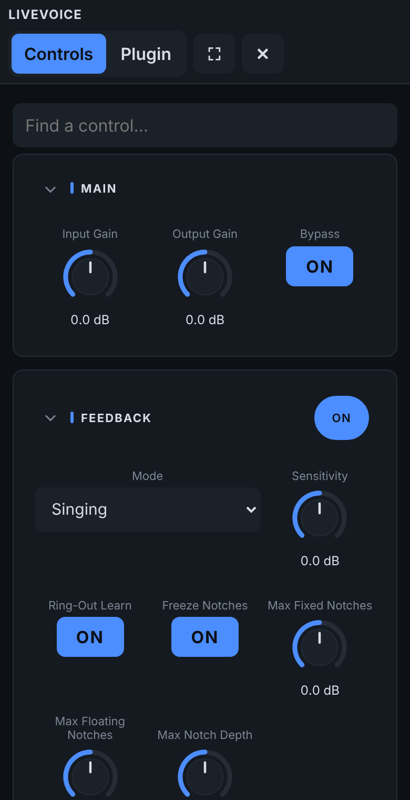

All of the plugin's settings as large touch controls, grouped into sections.

- **Sections** come from the plugin itself when it declares them. Otherwise LivePi works them out from the setting names, for example "Comp Threshold" goes under **Compressor** and "Band 2 Gain" under **Dynamic EQ · Band 2**. Tap a section header to fold it. On a phone only the first two sections start open, and LivePi remembers what you open.
- A section's **ON/OFF** switch sits in its header; the section dims when off.
- **Knobs:** drag up or down. **Double-tap** to return to the default. On a computer, use the mouse wheel, or hold Shift for fine moves.
- **Switches** toggle ON/OFF; **lists** pick a choice.
- **Find a control…** filters by name.
- Changes made elsewhere (for example in the Plugin screen) show up here within a second.

### Plugin screen

The plugin's own interface, drawn on the Pi and shown inside the page. You can use it with touch, mouse and keyboard.

| Control | What it does |
|---|---|
| **Tap / drag / scroll** | Works the plugin's knobs and buttons. Right-click works on a computer. |
| **Pinch** | Zoom in and out. |
| **Two fingers** | Move around while zoomed. |
| **− / Fit / +** | Zoom out, fit the whole plugin, zoom in. The middle button shows the zoom percentage. |
| **✋** | Move mode: drag with one finger to look around instead of touching the plugin. |
| **⌨** | Opens the phone's keyboard for typing values into the plugin. |
| **⛶** | Full screen. |

The plugin keeps its wide shape on a portrait phone, so start from **Fit** and zoom in. One plugin screen can be open at a time. Plugin screens use some CPU on the Pi, so use them for setup rather than during a show; the Controls view is lighter.

---

### Mixer mode (built-in LiveVoice channels)

LivePi has two modes, set for the whole Pi in **⚙ → Settings → Mode**:

- **VST rack:** each channel is a row of the rack running the VST plugins you load (everything above).
- **Mixer:** each channel has the **LiveVoice modules built in**: the same processing code as the LiveVoice plugin, without loading a plugin. All modules are **zero latency**, in any order, so the chain adds no delay.

Switching keeps everything: your VST chains wait untouched while you're in mixer mode, and your mixer settings wait while you're in VST mode. The audio stops for a moment when you switch.

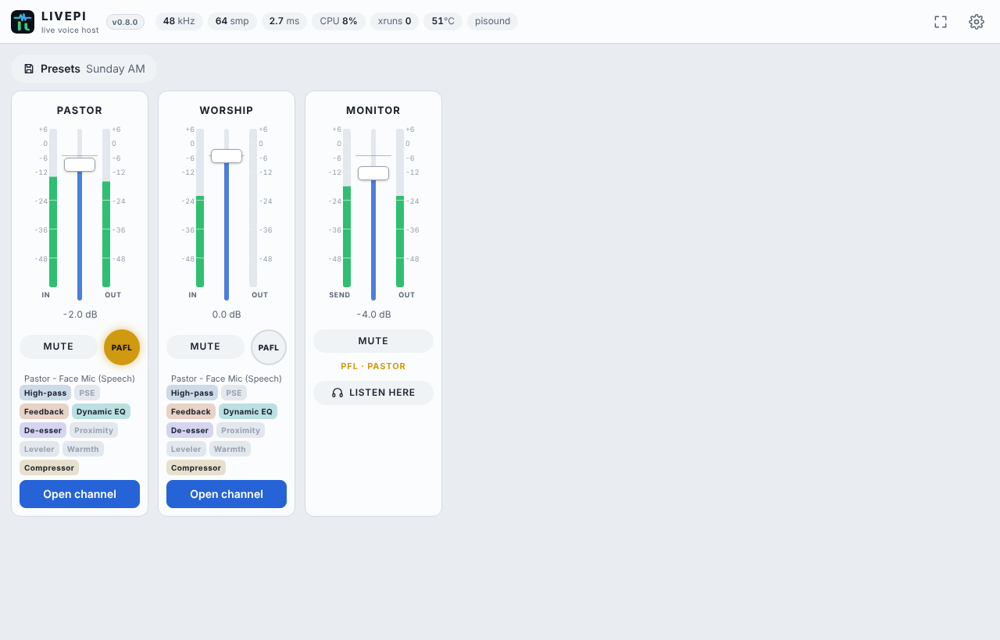

On the mixer, each channel shows its voice preset and its modules in flow order (lit = on). Tap **Open channel**:

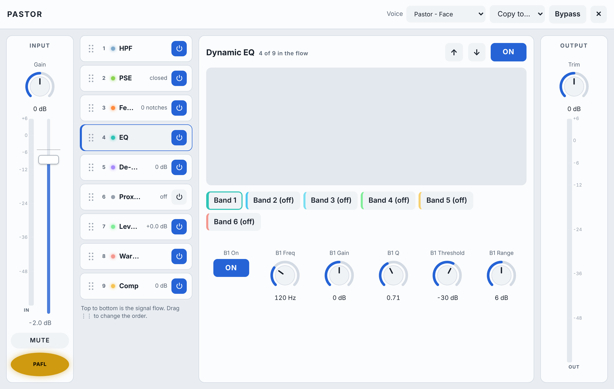

| Area | What it does |
|---|---|
| **Flow** | **Input** (gain and polarity) is always first and can't be removed. Then the modules, numbered in signal order: a list on a computer, a grid of tiles on a phone or tablet. Each shows a status (gain reduction, notch count, open/closed) and its **power** button. **Tap a module** to open its controls. **Drag the ⋮⋮ grip** to move it (computer); the **↑ ↓** buttons at the top of the panel move it one place (everywhere). **Remove** (top of the panel) takes a module out of the flow: it isn't processed at all, and its settings are kept. **+ Add module** puts one back, after the module that is open, or adds **another one** of a kind already in the flow: up to 2 high-pass filters, 2 dynamic EQs, 3 compressors and 4 parametric EQs, each with its own settings ("Compressor 2"). The Input tile has a small level meter. |
| **Panel** | The selected module, large: its graph or meters, and all its controls as big touch knobs (on a phone: wide sliders), switches and lists. Double-tap a knob or slider for its default. |
| **Right: Output** | Output **trim**, the channel **fader** with the OUT meter (after the fader), **Mute** and **PAFL**. Always on the right. |
| **Top bar** | The channel's **name**: tap it (✎) to rename the channel. **Voice**: load a voice preset (Pastor, Spoken Word, Male, Female, Worship Leader, and **Lapel / Lavalier Mic** for clip-on mics: more gain before feedback, the chest resonance around 750 Hz cut, presence and air added back, no proximity control, leveler on); it replaces the module settings, not the gains. **Copy to…** copies this channel's settings and order to another channel. **Bypass** switches every module off at once. |

**The modules**

| Module | On the panel |
|---|---|
| **Input** | Input gain (before everything) and **Polarity invert**; the input level against −12 dB (also on the Input tile). |
| **High-pass** | RTA with the filter curve: **drag sideways on the graph** to move the cut-off. Frequency and slope. |
| **PSE** | Primary source expander: a history of the voice level (green while open, grey while closed), how far it turned down (orange line) and the range; **drag up/down on it** for the threshold. **Threshold** and **Range** are the two big sliders under the graph. Voice level against the threshold, open/closed, and how much it turns down; threshold, range, attack, hold, release, sidechain filters. |
| **Feedback** | RTA with the notches; **Ring-out learn** and **Freeze notches**; **Set by hand**: type a frequency, pick a depth and **Add notch**, or tap the graph where you hear the ring; the list of notches, where you can change a notch's frequency and depth, **Make fixed** and **Remove**; **Clear floating** and **Clear all**; mode, sensitivity, depth, width, limits. |
| **Dynamic EQ** | RTA with the EQ curve and the six band dots: **touch a dot and slide** to change its frequency (left/right) and gain (up/down); the panel switches to that band when you let go. **Flatten** puts every band back to 0 dB (and turns the dynamics off), keeping the frequencies. Band buttons pick the band whose controls are shown, including its dynamic settings. |
| **De-esser** | RTA with the live cut, gain reduction; S and SH bands, mode, threshold, range, follow, relative detection. |
| **Proximity** | How much low end it takes out when the singer gets close; maximum cut. |
| **Leveler** | A history of the level against the target and the gain it adds or takes away (drag up/down on it for the target); the **Target** slider; level and gain meters (it holds while feedback is being caught). |
| **Warmth** | Amount (off at 0 %). |
| **Parametric EQ** | Not in the flow at first: add it with **+ Add module**. A clean, zero-latency 6-band EQ in the style of a modern studio parametric: every band can be a **Bell**, **Low Shelf**, **High Shelf**, **Low Cut**, **High Cut** (6 to 48 dB/oct) or **Notch**, from 20 Hz to 20 kHz, ±18 dB, Q 0.1 to 18. **Proportional Q** narrows a bell as you boost or cut it more, like a console EQ. **EQ Output** trims its level. Each band is a numbered dot on the graph: slide it as with the Dynamic EQ. **Flatten** puts every band back to 0 dB (cut and notch bands off). Voice presets leave it as it is. |
| **Compressor** | The **curve** (input across, output up, with a dot for the live level) and the **history** (input, output and gain reduction over the last 25 seconds). Drag sideways on the curve, or up and down on the history, to set the **threshold**. Input level against the threshold, gain reduction and makeup; threshold, ratio, knee, attack, release, auto release, makeup, mix, sidechain HP, auto gain. |

The high-pass filters in the flow are drawn faintly (dashed) behind the other modules' curves. The analyser behind the curves shows the channel's output, or its input: choose in **⚙ → Settings → Mode → RTA shows**.

On a phone, all nine modules sit as tiles across the top, so every one is a single tap away. Below them: input on the left, the panel, output on the right. The controls are wide sliders: **drag sideways** (the page still scrolls up and down), tap **−** / **+** for fine steps, double-tap the slider for its default:

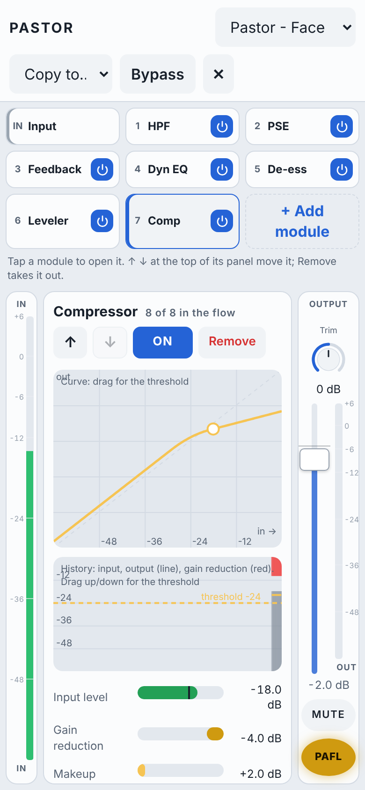

**Presets:** LivePi's presets (Presets on the mixer) save mixer channels too, including module order and the learned fixed notches. Safe mode (see section 11) runs mixer channels unprocessed, so the voice always passes.

**CPU:** one channel with every module on uses about 1 % of one core on the ARM64 build machine (more on a Pi, still small), so many channels fit.

## 8. Setup pages

Press **⚙** (top right). The pages are on the left, as a column of icons on a phone. **Done** returns to the mixer.

### 8.1 Audio

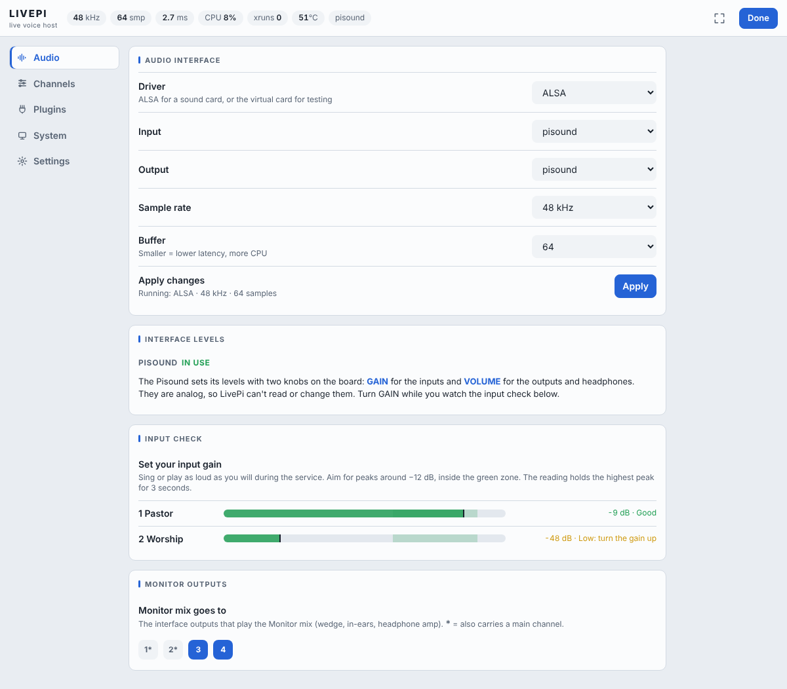

| Setting | Meaning |
|---|---|
| **Pisound found → Use Pisound** | Appears when a Pisound is fitted but not in use. Selects it for input and output at 48 kHz and 64 samples. |
| **Driver** | **ALSA** for a real sound card, or **Virtual (no audio hardware)** for testing. |
| **Input / Output** | The device to use. On the virtual card the input can be a test tone, pink noise, a sweep, silence or **Test file (loop)**. |
| **Sample rate** | 48 kHz is a good default. 96 kHz halves the delay but uses more CPU. |
| **Buffer** | Start at **64**; use 128 if xruns appear. |
| **Apply** | Uses the settings above. The line below shows what is running now. |
| **Interface levels** | The sound card's own controls: input gain, output volume, on/off switches and input choices, where the card has them (for example a Pisound Micro or a HiFiBerry DAC+ ADC). Changes take effect at once and LivePi puts them back after a restart. The original **Pisound** has no software controls: its **GAIN** (inputs) and **VOLUME** (outputs and headphones) knobs are analog, so LivePi can't read them. |
| **Input check** | A live bar per channel showing the raw input before any plugins, with the highest peak held for 3 seconds and advice: *No signal*, *Low: turn the gain up*, *Good*, *Hot*, or *Clipping: turn the gain down*. Sing or play as loud as you will in the service and set the gain so peaks sit around −12 dB, inside the green zone. |
| **Monitor outputs** | Which interface outputs play the Monitor mix (see [Monitoring](#6-monitoring-pafl)). |
| **Test audio file** | Only shown when the virtual card's input is **Test file (loop)**. Choose a WAV, AIFF, FLAC or OGG of up to 10 minutes, for example a voice recording, and press **Upload**. It then plays in a loop as the input. |

If no sound card is found at start-up, LivePi falls back to the virtual card for that session, and uses the real card again as soon as it's back.

### 8.2 Channels

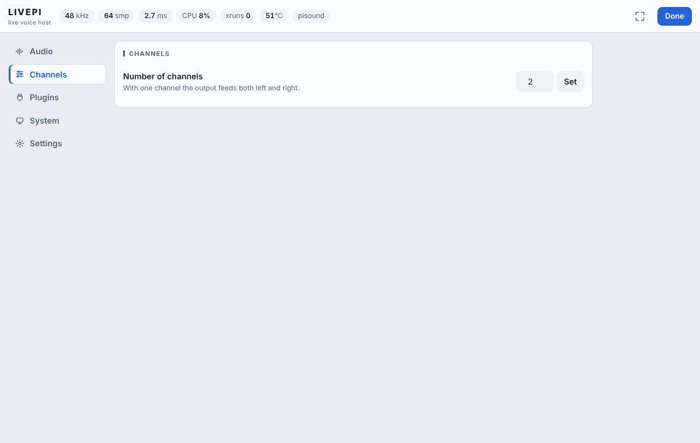

**Number of channels** (1–16): set it and press **Set**. Each channel has its own input, plugin chain and output.

### 8.3 Plugins

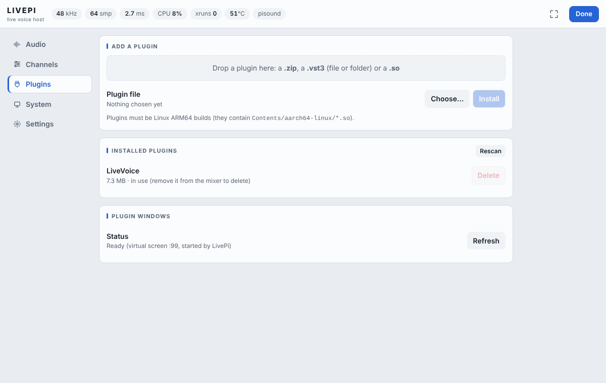

- **Add a plugin:** press **Choose…** and pick a `.zip`, a `.vst3` file or a `.so` file, then **Install**. On a computer you can also drag a whole `.vst3` folder onto the drop area. A bare `.so` or `.vst3` file is wrapped into a proper plugin bundle for you. The plugin must be a **Linux ARM64** build.
- **Installed plugins:** each uploaded plugin with its size. **Delete** is grayed out while the plugin is in use on a channel. **Rescan** (in the header) looks for plugins again; you only need it if one is missing from the Add list.
- **Plugin windows:** shows whether the Plugin screen view is ready, using a quick screen test, and says what is wrong if not.

### 8.4 System

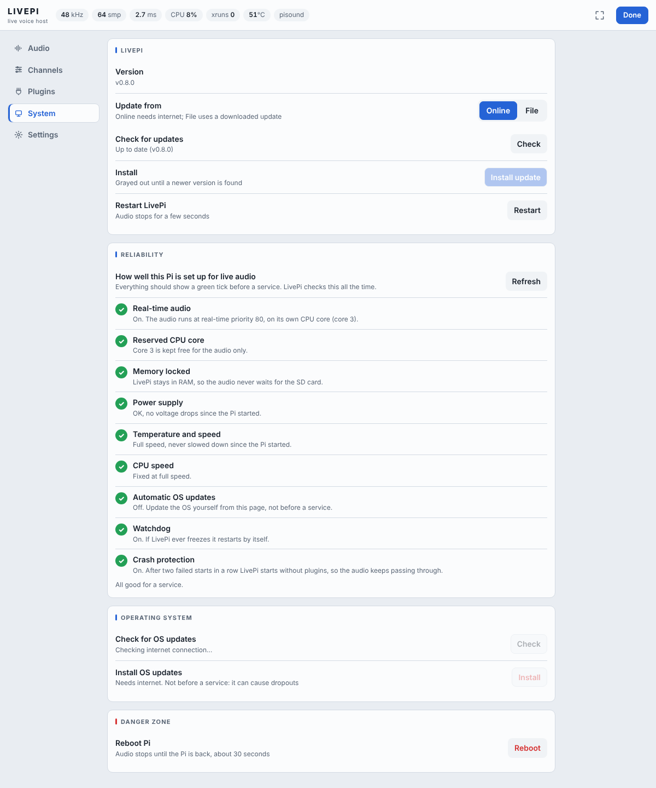

| Item | Meaning |
|---|---|
| **Version** | The installed LivePi version, for example *v0.8.0*. |
| **Update from: Online / File** | Online checks GitHub; File installs a downloaded update. |
| **Check for updates** | Looks for a newer release (needs internet). |
| **Version to install** | **Latest**: the newest release. **Install update** is grayed out (*Up to date*) until a newer version is found. **Other version**: pick any released version from the list, newer or older, and press **Upgrade**, **Downgrade** or **Reinstall**. Older versions don't have the features added since then; presets, plugins and settings are kept, and you can upgrade again at any time. |
| **Restart LivePi** (Danger zone) | Restarts the program. Audio stops for a few seconds. |
| **Reliability** | One line with a green tick (*Ready for a service*) when everything is fine; tap it to open the full checklist of everything that protects the audio: real-time priority, the reserved CPU core, memory lock, power supply, temperature, CPU speed, automatic OS updates, the watchdog and crash protection. See [Reliability and latency](#11-reliability-and-latency). |
| **Operating system** | Checks for and installs Raspberry Pi OS updates. Needs internet. Don't run it right before a service: it can cause dropouts and may need a reboot. |
| **Danger zone → Reboot Pi** | Restarts the whole Pi, which takes about 30 seconds. |

### 8.5 Settings

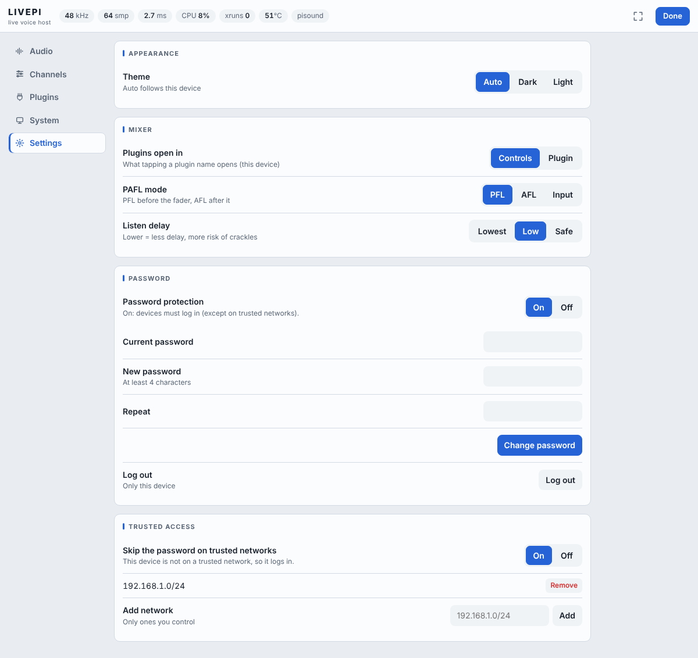

| Setting | Meaning |
|---|---|
| **Setup assistant** | **Run setup** walks through the first-start questions again. |
| **Mode** | **VST rack** or **Mixer** for the whole Pi (see [Mixer mode](#mixer-mode-built-in-livevoice-channels)). VST rack also shows **Plugins open in** (Controls or Plugin, when you tap a plugin name); Mixer shows **RTA shows** (Input or Output: what the analyser behind the curves measures). Both are saved on this device only. |
| **Monitoring** | **PAFL mode** (PFL, AFL or Input, for all channels, saved in presets) and **Listen delay** (Lowest, Low or Safe, for *Listen here* on this device). |
| **This device: Theme** | Auto (follows the device), Dark or Light. |
| **This device: Keep screen awake** | On: the screen doesn't dim or lock while LivePi is open, handy for an iPad on the desk. Saved on this device only. If it says *tap anywhere to start it*, tap the page once. Keep the iPad on power. |
| **Pisound button** | What each click or hold of the Pisound's button does. See [The Pisound button](#the-pisound-button). |
| **Password** | See the next section. |
| **Trusted access** | See the next section. Only shown while password protection is on. |
| **Network** | IP settings for the wired and Wi-Fi connections: **Automatic (DHCP)** or **Static** (IP address, subnet mask, gateway, DNS servers). See below. |

### The Pisound button

LivePi reads the Pisound's button itself; Blokas' button software is not needed. **⚙ → Settings → Pisound button** sets what each press does:

| Press | How |
|---|---|
| **1 click**, **2 clicks**, **3 clicks** | Quick presses; LivePi waits 0.4 s after the last one to count them. |
| **Hold 2 s** | Hold for 2 to 5 seconds, then let go. The LED flashes once at 2 seconds. |
| **Hold 5 s** | Keep holding: it acts the moment the LED flashes again, at 5 seconds. |

Actions: **Mute / unmute a channel**, **Mute / unmute every channel**, **Bypass a channel's effects** (the mixer channel's modules, or a VST channel's plugins), **Next** or **Previous saved preset** (in name order), **Clear learned feedback** (mixer mode), **Mute / unmute the monitor mix**, **Restart LivePi in safe mode** (holds only) and **Shut down the Pi** (the 5-second hold only, so it can't happen by accident). Every press starts as **Nothing**.

The card shows whether the button is **Pressed**, and the **Last press** with what it did, so you can try each one. The LED flashes once to confirm an action. **Use the button: Off** ignores every press.

If the card says **Blokas' button program is running**, tap **Turn it off**: otherwise both programs act on the same presses, and Blokas' 5-second hold shuts the Pi down. If it says LivePi *is not allowed to read the button*, tap **Fix it**. The installer asks about both (*Let LivePi use the Pisound button?*).

### Network settings

⚙ → Settings → **Network** shows each connection (Wired, Wi-Fi) with its current address, gateway, DNS and MAC address. **this page** marks the connection you're using.

- **Automatic (DHCP):** the router gives the Pi its address. This is how a Pi starts out.
- **Static:** a fixed address, so the Pi is always at the same place. Enter the **IP address**, **subnet mask** (usually 255.255.255.0), **gateway** (your router) and, optionally, up to three **DNS servers**. LivePi checks the values before applying, for example that the gateway is in the same subnet. On a church or AV network, pick an address outside the router's DHCP range, or reserve it in the router.

Press **Apply** and confirm. The audio keeps running; only the network connection drops for a few seconds.

**You can't lock yourself out.** Every change undoes itself after 2 minutes unless the page reaches the Pi at its new settings. If you change the connection this page uses, the page waits for the Pi at the new address and opens it there, which confirms the change. If that address doesn't work (a typo, the wrong subnet), the old settings come back by themselves after 2 minutes. Then open the old address again, and the card says what happened. When you switch to Automatic, the new address comes from the router, so the page opens at `livepi.local` (your Pi's name) instead.

Wi-Fi networks and passwords are set when the SD card is written (Raspberry Pi Imager); this card only sets the IP settings of a connection that already exists.

On Pis installed before v0.16, the card first shows a **one-time setup** with a copyable installer command, like the Reliability card.

---

## 9. Password, login and trusted access

| Situation | What happens |
|---|---|
| **No password**, or **protection Off** | Everyone on your network can use LivePi without logging in. |
| **Protection On** | Every device logs in once with the password (no user name). |
| **Protection On + Trusted access On** | Devices on the trusted networks you list skip the login; all others log in. |

- **Set or change the password:** Settings → Password. Changing it needs the current password, keeps this device logged in, and logs out all others.
- **Turn protection Off:** one tap. It never asks for the password.
- **Turn protection On:** always asks you to type the password to use from then on, either your old one or a new one, so you can't switch it on without knowing it.
- **Log out:** Settings → Password → Log out. This affects only this device.
- **Trusted access:** add networks such as `192.168.1.0/24`, or single addresses. Only use networks you control, such as a dedicated AV VLAN, because anyone on them gets full control, including plugin uploads and reboot.
- **Forgot the password?** On the Pi, run `sudo /opt/livepi/set-password.sh --off` to turn protection off, or `sudo /opt/livepi/set-password.sh` to choose a new password. Either one also clears any lockout.

LivePi uses plain HTTP, so keep the Pi on your own network and never expose it to the internet.

---

## 10. Updating

LivePi uses **major.minor.patch** versions (for example 0.8.0):

- **Patch** (0.8.1): fixes.
- **Minor** (0.9.0): new features.
- **Major** (1.0.0): big milestones.

A new version appears on the [Releases page](https://github.com/leonidis2013/LivePi/releases) as "LivePi vX.Y.Z".

- **Online:** ⚙ → System → **Update from: Online** → **Check**, then **Version to install: Latest** → **Install update**, or **Other version** to pick any release.
- **Offline:** download `livepi-build-N.zip` from the Releases page, then use ⚙ → System → **Update from: File** → **Choose…** → **Install update**.

Presets, plugins, password and settings are kept. If a new version fails to start three times in a row, LivePi puts the previous version back by itself and shows a notice. Some releases need the newer installer; the update tells you if so. In that case run the installer again (section 2.2).

---

## 11. Reliability and latency

### What LivePi does to keep the audio running

| Protection | What it does |
|---|---|
| **Real-time audio** | The audio runs at real-time priority, ahead of everything else on the Pi, including the web page, plugin screens and the OS. Denormals (tiny numbers that can make plugin math suddenly slow) are flushed to zero. |
| **Reserved CPU core** | With the installer's tuning, one CPU core is kept for the audio alone and nothing else ever runs on it. |
| **Memory locked** | LivePi stays in RAM, so the audio never waits for the SD card. |
| **Soft start** | Outputs stay silent for under a second while the converters and plugins settle after start-up, then fade in. |
| **Watchdog** | Checks the audio four times a second. If the sound card stops, LivePi reopens it. If a plugin hangs and freezes the audio, or hangs while loading at start-up, LivePi restarts itself within a few seconds. If LivePi ever freezes completely, the system restarts it within 30 seconds. A banner tells you what happened and when. |
| **Crash recovery** | After a crash LivePi starts again within about a second and reloads your session. |
| **Safe mode** | If LivePi crashes twice in a row while starting, or a plugin freezes the audio three times within 10 minutes, it starts **without plugins**, so your voice still passes through unprocessed. A banner offers **Load my session with plugins** or **Keep going without plugins**. Safe mode stays on, even after a restart, until you choose. Your plugins are never lost: the session with plugins is kept the whole time. |
| **Sound card reconnect** | If the sound card isn't ready when the Pi boots, or a USB interface is unplugged, LivePi uses the virtual card or waits, and switches back to the real card by itself as soon as it appears. |
| **Session backup** | A copy of your session is kept after every good start. If the session file is ever damaged (for example by a power cut), LivePi loads the copy. |
| **Power and heat warnings** | The top bar shows **⚡ Low power**, **Throttled**, **⚡ Power dipped** or **Was throttled** when the Pi's power supply or temperature is causing it to slow down, the most common hidden cause of dropouts on a Raspberry Pi. |

**⚙ → System → Reliability** sums all of this up in one line: a green tick and *Ready for a service* when everything is fine. Tap it to open the full checklist. Anything that needs attention is shown straight away under that line, highlighted with a **!**: tap one and a popup explains what is wrong, why it matters, and fixes it:

- **Fix**: changes that one setting with one tap; nothing else is changed. If the fix needs a restart, the item then says *Fixed. Reboot to finish* and the popup offers **Reboot now**.
- **How to fix**: for things only you can fix, like the power supply or cooling, the popup lists what to do.
- **One-time setup first**: on Pis installed before v0.11, changing system settings needs administrator permission, which only the installer can give, once. The popup shows the command with a **Copy command** button: open a terminal on the Pi the same way you did to install LivePi, paste it, and press Enter at each question to keep your settings. Then tap **Check again**.

The **⚡ Power** and **Throttled** warnings in the top bar open the same popup.

### What the installer's tuning changes

The installer runs `rt-tune.sh`, which:
- reserves the last CPU core for the audio (`isolcpus`),
- switches the kernel to full preemption (`preempt=full`) when the kernel supports it,
- turns off USB power saving,
- turns off automatic background OS updates (update from ⚙ → System instead),
- turns off Wi-Fi power saving,
- tells the system never to stop restarting LivePi and never to pick LivePi when memory runs out,
- lets LivePi read the Pisound button and flash its LED, and turns off Blokas' own button program (`pisound-btn`) so only LivePi acts on presses.

The boot settings take effect after a reboot. To see them, run `sudo /opt/livepi/rt-tune.sh status`. To undo them, run `sudo /opt/livepi/rt-tune.sh undo`.

### Before a service

- **Power:** use the official supply (27 W USB-C for a Pi 5, 15 W for a Pi 4). A weak supply or a thin cable causes dropouts and crashes; watch for ⚡ in the top bar.
- **Cooling:** use a fan or a good heatsink case. Throttling shows in the top bar.
- **Check the Reliability card** (⚙ → System): all green.
- **Tap xruns to reset it**, then watch it during the soundcheck. It should stay at 0.
- **Avoid during the service:** plugin screens, the CPU test, OS updates, uploading plugins and changing audio settings.
- **Network:** a wired connection is steadier for the page. The audio doesn't depend on the network at all.

### Latency

- Use a HAT like the **Pisound** rather than USB where possible.
- **Buffer 64 at 48 kHz** gives about 3 ms in-to-out before plugins. 96 kHz with 64 roughly halves that but uses more CPU. Raise to 128 if the **xruns** counter climbs.
- Plugins can add their own delay, for example any look-ahead.
- Run one Pi per job.

---

## 12. Troubleshooting

| Problem | What to try |
|---|---|
| **The page doesn't open** | Use the Pi's IP address instead of `livepi.local` (run `hostname -I` on the Pi, or check your router). Check the service: `sudo systemctl status livepi`. |
| **LivePi doesn't start after a reboot** | ⚙ → System → Reliability shows **Starts at boot**: tap it to fix it. From the Pi: `sudo systemctl enable --now livepi`, then `systemctl status livepi` and `sudo journalctl -u livepi -b -n 50` show why it stopped. |
| **"Connection to LivePi lost"** | The Pi is rebooting, restarting, or off the network. The page reconnects by itself. |
| **No sound / no audio device** | ⚙ → Audio: pick the right driver and device and press Apply. `aplay -l` on the Pi lists the cards Linux sees. For a Pisound, run `sudo /opt/livepi/pisound-setup.sh status`. |
| **Crackles or rising xruns** | Raise the buffer (64 → 128), check the temperature, and remove heavy plugins. |
| **A plugin won't install** | It must be a Linux ARM64 VST3 (it contains `Contents/aarch64-linux/*.so`). |
| **Plugin screen is blank or missing** | ⚙ → Plugins → Plugin windows shows the cause. Restart LivePi; if packages are missing, run the installer again. |
| **"A session is already in progress"** | Another device has control. Press **Take over**, or wait for it to go idle. |
| **Locked out by wrong passwords** | Wait for the countdown, or run `sudo /opt/livepi/set-password.sh --off` on the Pi. |
| **A banner says LivePi restarted itself** | The watchdog recovered from a frozen plugin or sound card. If it happens again, check that plugin (try the service without it) and the power supply. |
| **Safe mode banner** | LivePi crashed twice while starting. Press **Load my session with plugins**. If it crashes again, one of the plugins is the cause: remove it, or keep going without plugins. |
| **See what LivePi is doing** | `sudo journalctl -u livepi -n 50` |

---

## 13. Command reference (on the Pi)

| Command | Purpose |
|---|---|
| `sudo /opt/livepi/set-password.sh` | Set or change the password (turns protection on). |
| `sudo /opt/livepi/set-password.sh --off` | Turn password protection off. Use this if you forgot the password. |
| `sudo /opt/livepi/set-password.sh --on` | Turn protection back on (asks for the password to use). |
| `sudo /opt/livepi/trusted-network.sh add 192.168.1.0/24` | Add a trusted network (also `remove`, `list`, `clear`). |
| `sudo /opt/livepi/trusted-network.sh on` / `off` | Turn trusted access on or off. |
| `sudo /opt/livepi/rt-tune.sh` | Apply the live-audio tuning (also `status`, `undo`). Reboot afterwards. |
| `sudo /opt/livepi/pisound-setup.sh` | Set up the Pisound driver (also `status`, `disable`). Reboot afterwards. |
| `sudo systemctl restart livepi` | Restart LivePi. |
| `sudo journalctl -u livepi -n 50` | Show LivePi's recent log. |

---

## 14. Where LivePi keeps its files

| Location | Contents |
|---|---|
| `/opt/livepi/` | The program, the web page and the helper scripts. |
| `~/.livepi/` | Your data: audio settings, plugin list, `plugins/` (uploaded plugins), `presets/`, `last.json` (last session), password (`auth.json`, stored as a salted hash), trusted networks, sessions. |

To start completely fresh, stop LivePi (`sudo systemctl stop livepi`), delete `~/.livepi`, and start it again.
