# LivePi User Manual

**LivePi v0.8** · Copyright © Jerod Ulicki

LivePi turns a Raspberry Pi into a small, headless VST3 host for live voice. Audio goes in through the Pi's sound card, through your plugins (for example LiveVoice), and back out with very little delay. You control everything from a web page on a phone, tablet or computer. The Pi needs no screen, keyboard or mouse.

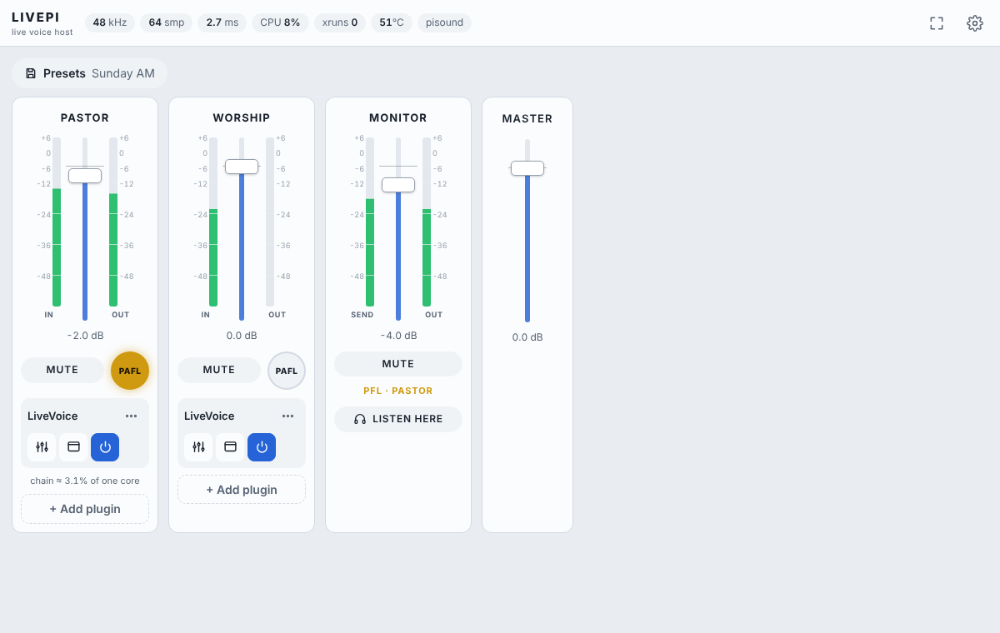

---

## Contents

1. [What you need](#1-what-you-need)
2. [Installing LivePi](#2-installing-livepi)
3. [Opening LivePi](#3-opening-livepi)
4. [The screen at a glance](#4-the-screen-at-a-glance)
5. [The mixer](#5-the-mixer)
6. [Monitoring (PAFL)](#6-monitoring-pafl)
7. [Working with plugins](#7-working-with-plugins)
8. [Setup pages](#8-setup-pages)
9. [Password, login and trusted access](#9-password-login-and-trusted-access)
10. [Updating](#10-updating)
11. [Getting the lowest latency](#11-getting-the-lowest-latency)
12. [Troubleshooting](#12-troubleshooting)
13. [Command reference (on the Pi)](#13-command-reference-on-the-pi)
14. [Where LivePi keeps its files](#14-where-livepi-keeps-its-files)

---

## 1. What you need

| Item | Notes |
|---|---|
| **Raspberry Pi 5** (recommended) or Pi 4 | A Pi 3 works with less headroom. Use a fan or a good heatsink. |
| **Raspberry Pi OS Lite, 64-bit** | Debian 13 "Trixie" (current) or Debian 12 "Bookworm". A 32-bit OS will not work. |
| **Audio interface** | Recommended: **Blokas Pisound** (¼" in/out, about 2 ms loopback). Any card Linux supports works, including class-compliant USB interfaces. You can also start with **no interface** by using the built-in virtual sound card. |
| **Your plugins** | VST3 plugins built for **Linux ARM64 (aarch64)**. Mac and Windows builds will not load. |
| **Network** | A wired connection is best for live use. Wi-Fi works for setup. |

---

## 2. Installing LivePi

### 2.1 Prepare the SD card

1. In [Raspberry Pi Imager](https://www.raspberrypi.com/software/), choose your Pi model and **Raspberry Pi OS Lite (64-bit)**.
2. Before writing, open the settings and set:
   - a **hostname** (for example `livepi`),
   - a **user name** and password,
   - **SSH** on,
   - your Wi-Fi details, if you need them.
3. Write the card, fit your audio interface (for example the Pisound), insert the card and power on. Wait about a minute.

### 2.2 Run the installer

From your computer, connect to the Pi and run:

```bash
ssh your-user@livepi.local
curl -L -o livepi.tar.gz https://github.com/leonidis2013/LivePi/releases/latest/download/livepi-linux-arm64.tar.gz
tar xzf livepi.tar.gz
cd livepi
sudo ./install-pi.sh your-user
sudo reboot
```

The installer sets up LivePi to start at boot, tunes the Pi for low-latency audio (real-time priority, CPU at full speed, PulseAudio and Bluetooth off) and installs the virtual screen used for plugin windows. It asks a few questions along the way:

| Question | What to answer |
|---|---|
| **Will you use a Blokas Pisound?** | **Y** if you have one. LivePi switches on its driver; nothing is downloaded. If a Pisound is already fitted and working, this is done without asking. |
| **Do you want to set a password? [Y/n]** | **Y** to protect the page with a password (at least 4 characters). **N** lets everyone on your network use LivePi. You can change this later in Settings. |
| **Turn on trusted access?** *(only after setting a password)* | **Y** lets devices on networks you trust skip the password. You then enter the network (the Pi's own network is suggested) and can add more. |

You can answer some of these up front:

| Option | Meaning |
|---|---|
| `--password` / `--no-password` | Set a password, or skip it, without being asked. |
| `--pisound` / `--no-pisound` | Set up the Pisound, or don't, without being asked. |
| `--no-editor` | Don't install plugin-window support (saves a little memory; the Plugin screen view is then unavailable). |

> **No internet on the Pi?** Download `livepi-linux-arm64.tar.gz` from the [Releases page](https://github.com/leonidis2013/LivePi/releases) on your computer, copy it over with `scp livepi-linux-arm64.tar.gz your-user@livepi.local:`, then continue from `tar xzf`.

> **Upgrading from LiveHost** (the old name)? Run the installer as above. It removes the old service and moves your settings, presets, plugins and password across automatically.

---

## 3. Opening LivePi

Open **`http://livepi.local:8080`** in any browser on the same network. If that name doesn't work, use the Pi's IP address instead, for example `http://192.168.2.120:8080`.

### Logging in

If password protection is on, LivePi shows its own login screen. Type the password only; there is no user name. Each device stays logged in for 30 days.

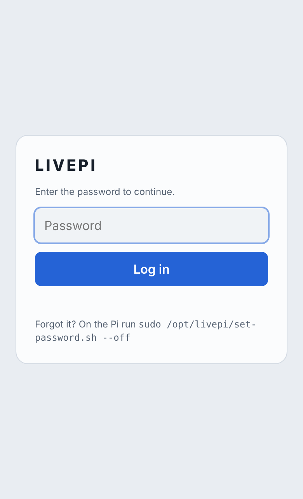

After **10 wrong passwords** that device is locked out for **10 minutes**. The login screen shows a countdown to the next allowed try, and each wrong attempt tells you how many tries are left.

### One device at a time

Only one device can control LivePi at a time. If someone is already using it, the next device sees **"A session is already in progress"**, with where it is in use from and for how long, and a **Take over** button. The device that was taken over then sees **"Another device took over"** with **Take back**.

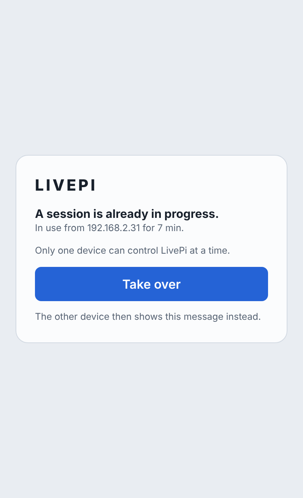

A device that closes the page, or leaves it in the background for about 12 seconds, frees LivePi, and the next device gets in without being asked.

### Full screen and "app" mode

- **Computer or iPad:** press the **⛶** button at the top right. Press it again or press Esc to leave.
- **iPhone or iPad:** in Safari use **Share → Add to Home Screen**. LivePi gets its own icon and opens full screen like an app.

---

## 4. The screen at a glance

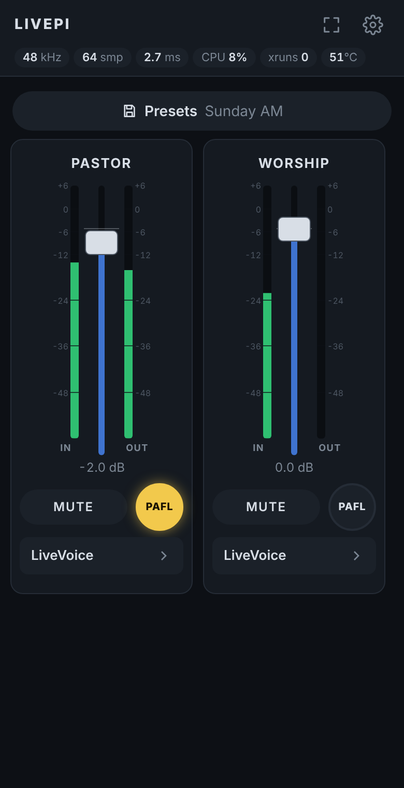

**Top bar**

| Item | Meaning |
|---|---|
| **kHz** | Sample rate of the audio interface. |
| **smp** | Buffer size in samples. Smaller means less delay but more CPU. |
| **ms** | Latency reported by the audio interface. The virtual card shows 0.0. |
| **CPU** | How busy the audio processing is. It turns red above 70 %. |
| **xruns** | Audio dropouts since start. It should stay at **0**; red means raise the buffer. |
| **°C** | Pi temperature. It turns red above 75 °C. |
| **⛶** | Full screen. |
| **⚙** | Opens the setup pages. In setup it becomes **Done**, which returns to the mixer. |

If the connection to the Pi is lost, the whole page grays out with **"Connection to LivePi lost. Reconnecting…"**. Nothing can be pressed until the Pi answers again, then everything comes back by itself.

---

## 5. The mixer

Each channel has its own strip.

| Part | What it does |
|---|---|
| **Name** | Tap to rename the channel. |
| **IN meter** | Level coming in, before the plugins. Scale +6 to −48 dB. |
| **Fader** | Channel level, from −∞ to +6 dB. **Double-tap** (or double-click) to reset to 0 dB. |
| **OUT meter** | Level going out, after the plugins and the fader. |
| **MUTE** | Silences the channel's output. |
| **PAFL** (round key) | Sends this channel to the Monitor mix (see [Monitoring](#6-monitoring-pafl)). It lights amber when on. |
| **Plugin chain** | The plugins on this channel, in order (see below). |

With one channel, its output feeds both left and right. With more channels, channel N goes to output N.

### Plugin chain

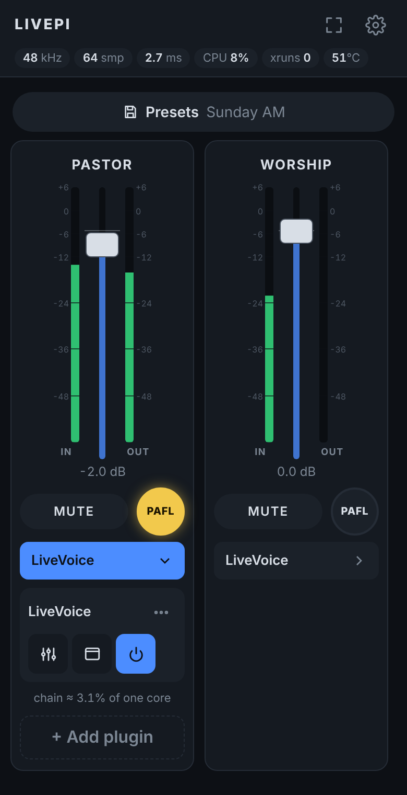

On a phone the chain is folded into one line, for example "LiveVoice ›". Tap it to open. Each plugin shows:

| Control | What it does |
|---|---|
| **Plugin name** | Tap to open the plugin in your preferred view (Settings → *Plugins open in*). |
| **Sliders icon** | Opens **Controls**: big touch knobs. |
| **Window icon** | Opens the **Plugin** screen: the plugin's own interface. |
| **Power icon** | On (blue) or bypassed (amber). |
| **⋯** | More: **CPU** estimates the plugin's CPU use with a test signal (not during a show), and the **trash can** removes it from the channel. |
| **+ Add plugin** | Pick an installed plugin and press **Add**. |

### Master

The Master fader controls all channel outputs. You can hide it in **Settings → Mixer → Master fader**; it keeps its level while hidden.

### Presets

Tap **Presets** to load a saved mix or save the current one under a new name. A preset stores channel names, faders, mutes, plugin chains and all plugin settings, the monitor mix, and the PAFL mode. The last session is restored automatically when the Pi starts.

---

## 6. Monitoring (PAFL)

LivePi has a **Monitor mix**, used like the PAFL bus on an Allen & Heath SQ, to feed a wedge, in-ears or headphones, or to listen on your phone.

1. Press **PAFL** on the channel you want to hear. Only one channel at a time; pressing another one moves the listen to it.
2. Choose where it is tapped in **Settings → Mixer → PAFL mode**. This applies to every channel:
   - **PFL**: after the plugins, before the channel fader (the default).
   - **AFL**: after the channel fader and mute.
   - **Input**: the raw input, before the plugins.
3. Set the level with the **Monitor** strip's fader. Everything you monitor goes through it. The strip shows the mode and channel, for example "PFL · PASTOR".
4. Choose where it plays:
   - **Interface outputs:** in **⚙ → Audio → Monitor outputs**, tick the outputs wired to your wedge, in-ear transmitter or headphone amp. Outputs marked **\*** already carry a main channel, so you normally leave those off.
   - **On your phone or computer:** press **Listen here** on the Monitor strip. It plays the monitor mix with a short delay (shown under the button). Choose **Lowest / Low / Safe** delay in **Settings → Mixer → Listen delay**. Listening only reads a copy of the audio, so it never delays the Pi's main outputs.

---

## 7. Working with plugins

Open a plugin by tapping its name, or with the Controls or Plugin icons. Switch views with **Controls | Plugin** at the top. **✕** closes the view.

### Controls view

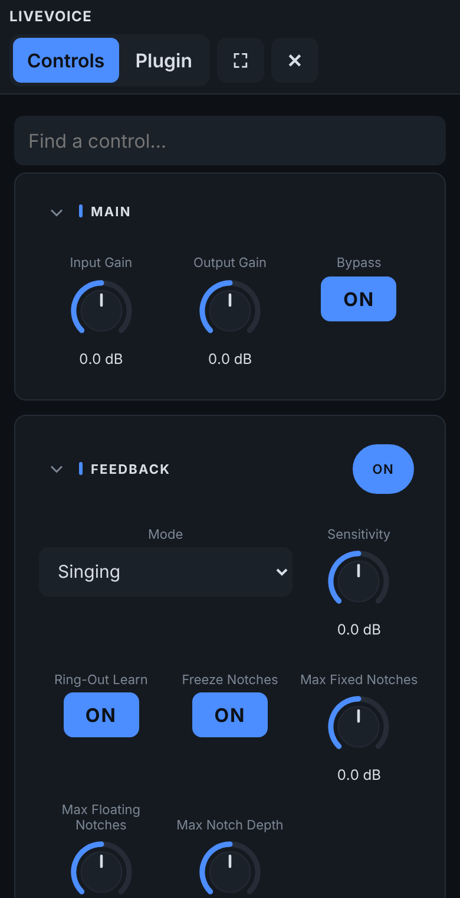

All of the plugin's settings as large touch controls, grouped into sections.

- **Sections** come from the plugin itself when it declares them. Otherwise LivePi works them out from the setting names, for example "Comp Threshold" goes under **Compressor** and "Band 2 Gain" under **Dynamic EQ · Band 2**. Tap a section header to fold it. On a phone only the first two sections start open, and LivePi remembers what you open.
- A section's **ON/OFF** switch sits in its header; the section dims when off.
- **Knobs:** drag up or down. **Double-tap** to return to the default. On a computer, use the mouse wheel, or hold Shift for fine moves.
- **Switches** toggle ON/OFF; **lists** pick a choice.
- **Find a control…** filters by name.
- Changes made elsewhere (for example in the Plugin screen) show up here within a second.

### Plugin screen

The plugin's own interface, drawn on the Pi and shown inside the page. You can use it with touch, mouse and keyboard.

| Control | What it does |
|---|---|
| **Tap / drag / scroll** | Works the plugin's knobs and buttons. Right-click works on a computer. |
| **Pinch** | Zoom in and out. |
| **Two fingers** | Move around while zoomed. |
| **− / Fit / +** | Zoom out, fit the whole plugin, zoom in. The middle button shows the zoom percentage. |
| **✋** | Move mode: drag with one finger to look around instead of touching the plugin. |
| **⌨** | Opens the phone's keyboard for typing values into the plugin. |
| **⛶** | Full screen. |

The plugin keeps its wide shape on a portrait phone, so start from **Fit** and zoom in. One plugin screen can be open at a time. Plugin screens use some CPU on the Pi, so use them for setup rather than during a show; the Controls view is lighter.

---

## 8. Setup pages

Press **⚙** (top right). The pages are on the left, as a column of icons on a phone. **Done** returns to the mixer.

### 8.1 Audio

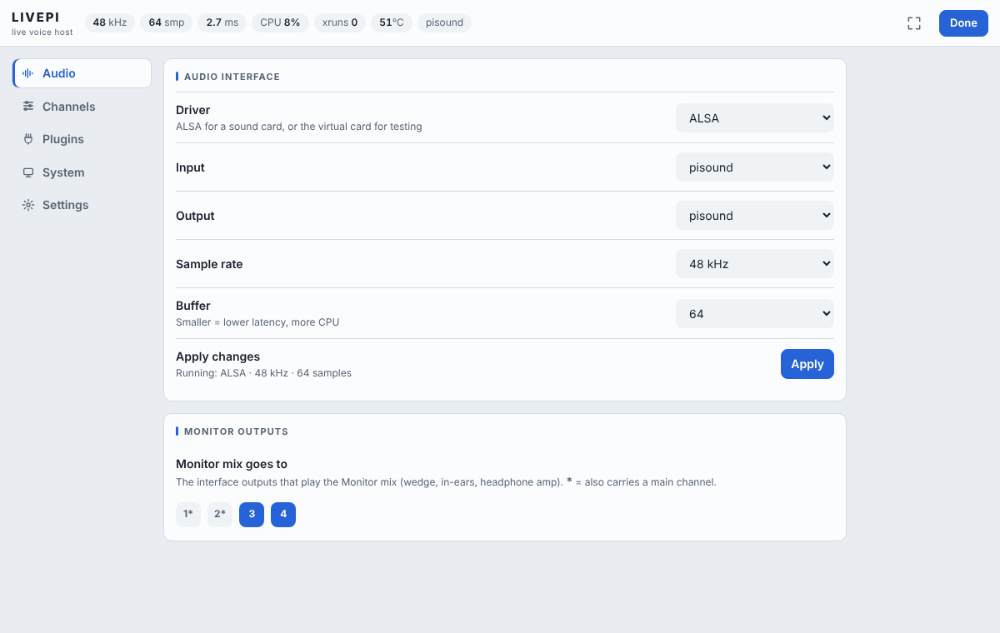

| Setting | Meaning |
|---|---|
| **Pisound found → Use Pisound** | Appears when a Pisound is fitted but not in use. Selects it for input and output at 48 kHz and 64 samples. |
| **Driver** | **ALSA** for a real sound card, or **Virtual (no audio hardware)** for testing. |
| **Input / Output** | The device to use. On the virtual card the input can be a test tone, pink noise, a sweep, silence or **Test file (loop)**. |
| **Sample rate** | 48 kHz is a good default. 96 kHz halves the delay but uses more CPU. |
| **Buffer** | Start at **64**; use 128 if xruns appear. |
| **Apply** | Uses the settings above. The line below shows what is running now. |
| **Monitor outputs** | Which interface outputs play the Monitor mix (see [Monitoring](#6-monitoring-pafl)). |
| **Test audio file** | Only shown when the virtual card's input is **Test file (loop)**. Choose a WAV, AIFF, FLAC or OGG of up to 10 minutes, for example a voice recording, and press **Upload**. It then plays in a loop as the input. |

If no sound card is found at start-up, LivePi falls back to the virtual card for that session, and uses the real card again as soon as it's back.

### 8.2 Channels

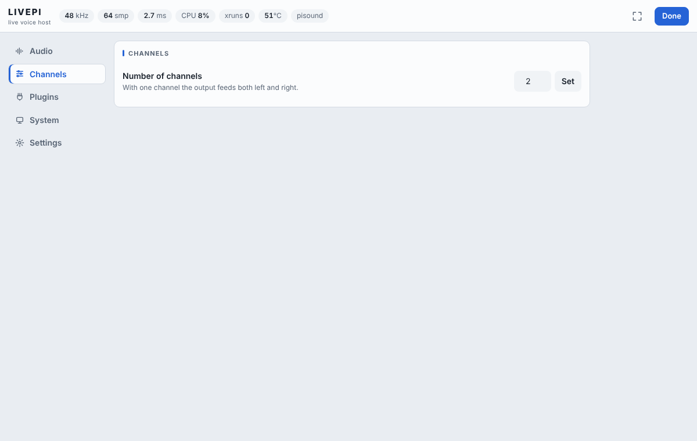

**Number of channels** (1–16): set it and press **Set**. Each channel has its own input, plugin chain and output.

### 8.3 Plugins

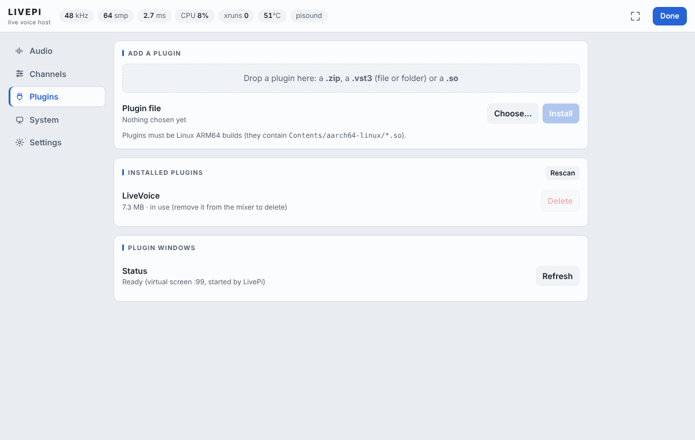

- **Add a plugin:** press **Choose…** and pick a `.zip`, a `.vst3` file or a `.so` file, then **Install**. On a computer you can also drag a whole `.vst3` folder onto the drop area. A bare `.so` or `.vst3` file is wrapped into a proper plugin bundle for you. The plugin must be a **Linux ARM64** build.
- **Installed plugins:** each uploaded plugin with its size. **Delete** is grayed out while the plugin is in use on a channel. **Rescan** (in the header) looks for plugins again; you only need it if one is missing from the Add list.
- **Plugin windows:** shows whether the Plugin screen view is ready, using a quick screen test, and says what is wrong if not.

### 8.4 System

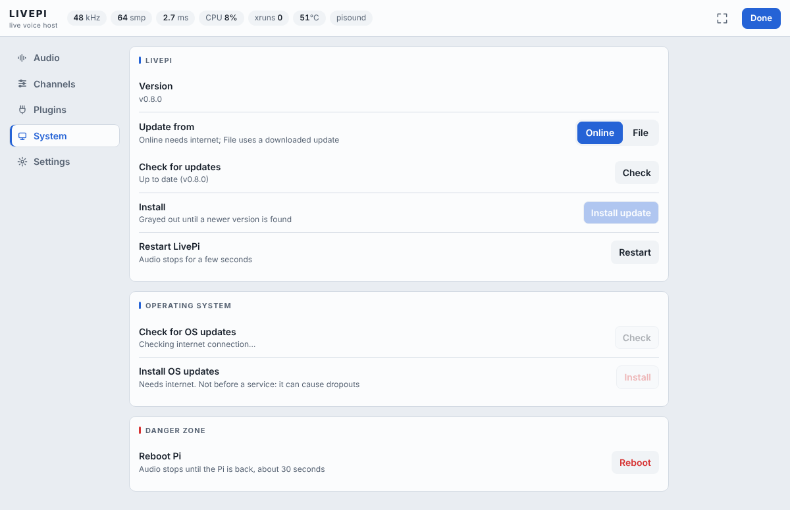

| Item | Meaning |
|---|---|
| **Version** | The installed LivePi version, for example *v0.8.0*. |
| **Update from: Online / File** | Online checks GitHub; File installs a downloaded update. |
| **Check / Install update** | Install is grayed out until a newer version is found, or until a file has been chosen. |
| **Restart LivePi** | Restarts the program. Audio stops for a few seconds. |
| **Operating system** | Checks for and installs Raspberry Pi OS updates. Needs internet. Don't run it right before a service: it can cause dropouts and may need a reboot. |
| **Danger zone → Reboot Pi** | Restarts the whole Pi, which takes about 30 seconds. |

### 8.5 Settings

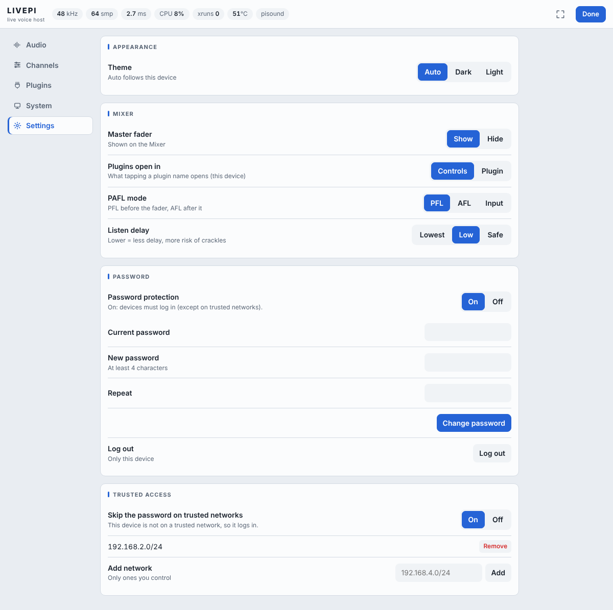

| Setting | Meaning |
|---|---|
| **Theme** | Auto (follows the device), Dark or Light. Saved on this device only. |
| **Master fader** | Show or hide it on the mixer. Saved on this device only. |
| **Plugins open in** | What tapping a plugin name opens: Controls or Plugin. Saved on this device only. |
| **PAFL mode** | PFL, AFL or Input, for all channels. Saved in presets. |
| **Listen delay** | Lowest, Low or Safe, for *Listen here* on this device. |
| **Password** | See the next section. |
| **Trusted access** | See the next section. Only shown while password protection is on. |

---

## 9. Password, login and trusted access

| Situation | What happens |
|---|---|
| **No password**, or **protection Off** | Everyone on your network can use LivePi without logging in. |
| **Protection On** | Every device logs in once with the password (no user name). |
| **Protection On + Trusted access On** | Devices on the trusted networks you list skip the login; all others log in. |

- **Set or change the password:** Settings → Password. Changing it needs the current password, keeps this device logged in, and logs out all others.
- **Turn protection Off:** one tap. It never asks for the password.
- **Turn protection On:** always asks you to type the password to use from then on, either your old one or a new one, so you can't switch it on without knowing it.
- **Log out:** Settings → Password → Log out. This affects only this device.
- **Trusted access:** add networks such as `192.168.2.0/24`, or single addresses. Only use networks you control, such as a dedicated AV VLAN, because anyone on them gets full control, including plugin uploads and reboot.
- **Forgot the password?** On the Pi, run `sudo /opt/livepi/set-password.sh --off` to turn protection off, or `sudo /opt/livepi/set-password.sh` to choose a new password. Either one also clears any lockout.

LivePi uses plain HTTP, so keep the Pi on your own network and never expose it to the internet.

---

## 10. Updating

LivePi uses **major.minor.patch** versions (for example 0.8.0):

- **Patch** (0.8.1): fixes.
- **Minor** (0.9.0): new features.
- **Major** (1.0.0): big milestones.

A new version appears on the [Releases page](https://github.com/leonidis2013/LivePi/releases) as "LivePi vX.Y.Z".

- **Online:** ⚙ → System → **Update from: Online** → **Check** → **Install update**.
- **Offline:** download `livepi-build-N.zip` from the Releases page, then use ⚙ → System → **Update from: File** → **Choose…** → **Install update**.

Presets, plugins, password and settings are kept. If a new version fails to start three times in a row, LivePi puts the previous version back by itself and shows a notice. Some releases need the newer installer; the update tells you if so. In that case run the installer again (section 2.2).

---

## 11. Getting the lowest latency

- Use a HAT like the **Pisound** rather than USB where possible.
- **Buffer 64 at 48 kHz** gives about 3 ms in-to-out before plugins. 96 kHz with 64 roughly halves that but uses more CPU. Raise to 128 if the **xruns** counter climbs.
- Plugins can add their own delay, for example any look-ahead.
- Use a **wired network**, keep the Pi cool (fan), and avoid plugin screens, the CPU test and OS updates during a service.
- Run one Pi per job. LivePi already sets the CPU to full speed and turns off audio services that get in the way.

---

## 12. Troubleshooting

| Problem | What to try |
|---|---|
| **The page doesn't open** | Use the Pi's IP address instead of `livepi.local` (run `hostname -I` on the Pi, or check your router). Check the service: `sudo systemctl status livepi`. |
| **"Connection to LivePi lost"** | The Pi is rebooting, restarting, or off the network. The page reconnects by itself. |
| **No sound / no audio device** | ⚙ → Audio: pick the right driver and device and press Apply. `aplay -l` on the Pi lists the cards Linux sees. For a Pisound, run `sudo /opt/livepi/pisound-setup.sh status`. |
| **Crackles or rising xruns** | Raise the buffer (64 → 128), check the temperature, and remove heavy plugins. |
| **A plugin won't install** | It must be a Linux ARM64 VST3 (it contains `Contents/aarch64-linux/*.so`). |
| **Plugin screen is blank or missing** | ⚙ → Plugins → Plugin windows shows the cause. Restart LivePi; if packages are missing, run the installer again. |
| **"A session is already in progress"** | Another device has control. Press **Take over**, or wait for it to go idle. |
| **Locked out by wrong passwords** | Wait for the countdown, or run `sudo /opt/livepi/set-password.sh --off` on the Pi. |
| **See what LivePi is doing** | `sudo journalctl -u livepi -n 50` |

---

## 13. Command reference (on the Pi)

| Command | Purpose |
|---|---|
| `sudo /opt/livepi/set-password.sh` | Set or change the password (turns protection on). |
| `sudo /opt/livepi/set-password.sh --off` | Turn password protection off. Use this if you forgot the password. |
| `sudo /opt/livepi/set-password.sh --on` | Turn protection back on (asks for the password to use). |
| `sudo /opt/livepi/trusted-network.sh add 192.168.2.0/24` | Add a trusted network (also `remove`, `list`, `clear`). |
| `sudo /opt/livepi/trusted-network.sh on` / `off` | Turn trusted access on or off. |
| `sudo /opt/livepi/pisound-setup.sh` | Set up the Pisound driver (also `status`, `disable`). Reboot afterwards. |
| `sudo systemctl restart livepi` | Restart LivePi. |
| `sudo journalctl -u livepi -n 50` | Show LivePi's recent log. |

---

## 14. Where LivePi keeps its files

| Location | Contents |
|---|---|
| `/opt/livepi/` | The program, the web page and the helper scripts. |
| `~/.livepi/` | Your data: audio settings, plugin list, `plugins/` (uploaded plugins), `presets/`, `last.json` (last session), password (`auth.json`, stored as a salted hash), trusted networks, sessions. |

To start completely fresh, stop LivePi (`sudo systemctl stop livepi`), delete `~/.livepi`, and start it again.
